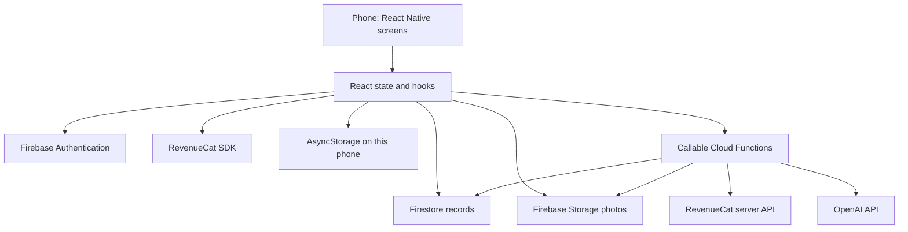
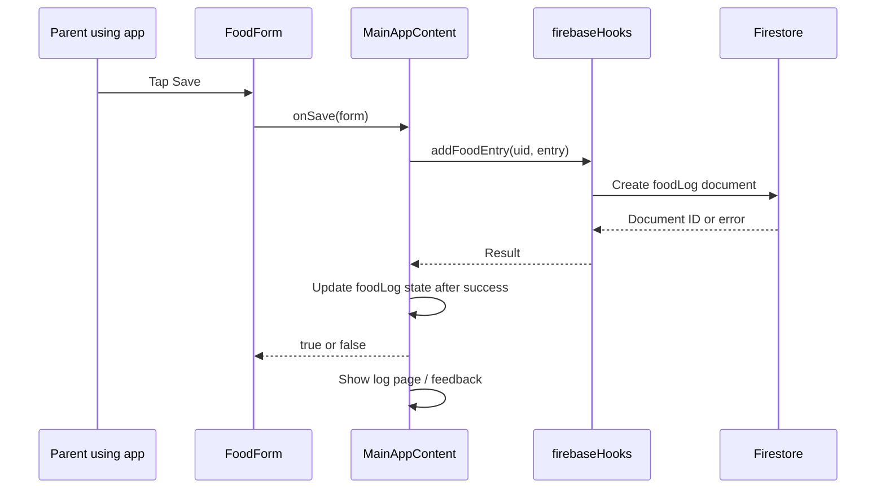

# Understanding and maintaining MunchSprouts

A practical guide for Jamie • Updated 21 October 2026 • App version 1.6.1

Latest structure: food entry opens in `src/components/AddFoodModal.js`, using the reusable `FoodForm`. `ActivityCalendar` and `activityCalendar.js` provide the log calendar; `Disclosure` supplies the expandable sections in settings, allergens and child profiles. `allergenCheckIn.js` owns 48-hour timing and `reminderSync.js` reconciles local reminders. The old unused `RemindersModal` and `notifications.js` have been removed. `App.js` waits for loaded data and preferences before reconciling reminders. See [the release review](release-audit-2026-10-21.md) for the current verification scope.


This guide describes the code in this repository, including the Android RevenueCat key correction. It is a teaching guide and a map of the implementation, not a certification that every deployed service is configured correctly. Firebase rules/functions, store settings and the app installed on a phone can each be at different versions.

Open this document in your editor's Markdown preview. The relative file links work in the repository and on GitHub. Search for the named functions rather than relying on line numbers, which move when code changes. All short examples marked “simplified” explain the pattern; they are not instructions to paste over your existing code.

## How to read this guide

Read sections 1–5 first to learn the vocabulary and startup flow. Then follow the food-save example in section 6. Use the page map and component index as references while editing. Finish with the maintenance exercises and release checklist.

- [1. The parts of your app](#1-the-parts-of-your-app)
- [2. Reading JavaScript and JSX](#2-reading-javascript-and-jsx)
- [3. State, props, hooks and rendering](#3-state-props-hooks-and-rendering)
- [4. Startup and navigation](#4-startup-and-navigation)
- [5. Files and responsibilities](#5-files-and-responsibilities)
- [6. Follow a food entry from tap to database](#6-follow-a-food-entry-from-tap-to-database)
- [7. How onboarding saves information](#7-how-onboarding-saves-information)
- [8. Every screen and its role](#8-every-screen-and-its-role)
- [9. Reusable components](#9-reusable-components)
- [10. Where information is stored](#10-where-information-is-stored)
- [11. Subscriptions and complimentary Pro](#11-subscriptions-and-complimentary-pro)
- [12. Sharing, permissions and deletion](#12-sharing-permissions-and-deletion)
- [13. Colours, styles and icons](#13-colours-styles-and-icons)
- [14. Recipes, AI and notifications](#14-recipes-ai-and-notifications)
- [15. Performance and asynchronous work](#15-performance-and-asynchronous-work)
- [16. Finding and changing things](#16-finding-and-changing-things)
- [17. Testing and diagnosing problems](#17-testing-and-diagnosing-problems)
- [18. Git, builds and deployment](#18-git-builds-and-deployment)
- [19. Practice exercises](#19-practice-exercises)
- [20. Current limitations to understand](#20-current-limitations-to-understand)
- [Appendix: actual component imports](#appendix-actual-component-imports)

## 1. The parts of your app

MunchSprouts is a React Native app managed with Expo. Most screens are written once in JavaScript and run on both iOS and Android. Native services still differ: Apple and Google handle their own purchases, device permissions and login integrations.

| Part | What it does | Where you work on it |
| --- | --- | --- |
| React Native | Turns components into native phone interface elements | `App.js`, `src/screens`, `src/components` |
| React | Manages component rendering, state and effects | Functions and hooks inside those files |
| Expo | Provides development/build tooling and APIs for photos, fonts, notifications and updates | `app.json`, `app.config.js`, Expo imports |
| Firebase Authentication | Identifies the signed-in account | `src/firebaseHooks.js`, `AuthScreen.js` |
| Cloud Firestore | Stores structured records: users, children, logs and preferences | Firebase helpers and some screens |
| Firebase Storage | Stores uploaded image files | Photo helpers and `storage.rules` |
| Cloud Functions | Runs trusted server operations | `functions/` |
| RevenueCat | Supplies purchase offerings and subscription entitlements | `useProSubscription.js`, `subscriptionSession.js` |
| Apple / Google Play | Handle payment and distribution | Store dashboards, signing and product configuration |
| AsyncStorage | Saves small pieces of data on this installation | Drafts, local theme/reminder choices |
| Git / GitHub | Records source changes and backs them up remotely | Terminal commands and repository |

**Client** means code running on the phone. **Server** means code running in Cloud Functions or another remote service. Users control their devices, so the server must check authorization independently of buttons being hidden in the app.

A simplified relationship diagram:



Changing source code on your Mac does not automatically update any of those remote services or an installed production app.

## 2. Reading JavaScript and JSX

You do not need to memorize the whole language to start reading the app. Learn these patterns first.

### Imports and exports

```javascript
import { FoodForm } from "./src/components/FoodForm";
```

This makes the exported `FoodForm` function available in the current file. `./` means “from this directory”; `../` means “go up one directory.” A package import such as `"react-native"` comes from `node_modules`.

```javascript
export function FoodForm(props) {
  // ...
}
```

`export` lets other files import it. `export default` identifies a file's default export; `App.js` uses this for the top-level `App` component. The server uses CommonJS equivalents such as `require(...)` and `module.exports`.

### Values, objects and arrays

```javascript
const entry = { name: "Banana", reaction: "Loved" };
const entries = [entry];
```

An object groups named fields. An array is an ordered list. `entry.name` reads a field. `entries[0]` reads the first item. `const` stops you assigning a different value to the variable; it does not freeze the object itself.

Frequently used syntax in your app:

| Syntax | Meaning | Why it appears here |
| --- | --- | --- |
| `user?.uid` | Read `uid` if `user` exists | Avoid an error while account data is loading |
| `value ?? fallback` | Use fallback only for `null`/`undefined` | Keep valid `false` preferences |
| `value || fallback` | Use fallback for any falsy value | Substitute a label when a string is empty |
| `{ ...form, name: value }` | Copy fields, then replace `name` | Update a form without mutating its old object |
| `condition ? a : b` | Choose between two values | Show selected or unselected styles |
| `items.map(fn)` | Produce one result per item | Render rows or transform database documents |
| `items.filter(fn)` | Keep only matching items | Select logs for the active child |
| `items.find(fn)` | Return the first match | Find a child or a subscription package |
| `items.some(fn)` | Ask whether any item matches | Check whether a food has a favourite attempt |
| `items.reduce(fn, initial)` | Combine items into one result | Sum milk amounts |
| `async` / `await` | Wait for asynchronous work | Save to Firestore or call RevenueCat |
| `try` / `catch` / `finally` | Handle success, failure and cleanup | Keep a form open when saving fails |

Order matters with spread syntax: `{ name: "A", ...form }` allows `form.name` to override `"A"`. Ownership/child identifiers should not accidentally be overridden by untrusted form fields.

### JSX: the interface inside JavaScript

```jsx
<View>
  <Text>{child.name}</Text>
  <PrimaryBtn label="Save" onPress={save} disabled={saving} />
</View>
```

JSX resembles HTML but uses native components. `View` is a layout container; `Text` displays text; `TextInput` collects input. Curly braces insert JavaScript values. `onPress={save}` passes a function to call later. `onPress={save()}` calls it immediately during rendering, which is usually wrong.

A custom component name such as `PrimaryBtn` is another function from your code. Follow its import to see how it builds its interface.

### Units and dates deserve attention

`helpers.js` contains `toMl`, `formatWeight`, `formatDate`, `calcAgeMonths` and related helpers. Keep stored values and display values separate: a weight may be stored in kilograms and displayed in pounds. Date-only strings such as `2026-10-19` represent calendar days; turning them into UTC timestamps casually can move a user's day across time zones. The code has local-date helpers and regression tests for this reason.

## 3. State, props, hooks and rendering

### Props flow down

Props are inputs a parent passes to a component. In `App.js`, a screen receives things such as `child`, `foodLog`, `isPro` and `onDelete`.

- `foodLog` is data the screen can display.
- `isPro` is a value used to choose the interface.
- `onDelete` is a callback the screen can invoke when the user requests an action.

The screen should not mutate its parent's array directly. It requests an action; the parent changes state or performs persistence.

### State remembers a component's current values

An actual navigation declaration from `App.js`:

```javascript
const [page, setPage] = useState("dashboard");
```

`page` is the current value. `setPage("log")` asks React to render with a new value. State survives normal re-renders, but is not permanent storage: restarting an app can lose it unless the value is also saved elsewhere.

```javascript
setFoodLog((previous) => [...previous, newEntry]);
```

This creates a new array based on the latest state. It avoids changing the old array in place. New references are important for React's change detection.

### Hooks used in this app

| Hook | Purpose | Example to search |
| --- | --- | --- |
| `useState` | Remember editable/display state | `page`, `form`, `modalVisible` |
| `useEffect` | Run work after rendering, and clean it up | Auth listeners, fetching data, update checks |
| `useMemo` | Reuse a calculated result until dependencies change | `childLog`, food groups, sorted milk days |
| `useCallback` | Reuse a function reference until dependencies change | Food list renderers, milk edit/repeat callbacks |
| `useRef` | Keep a mutable value without triggering a render | A save-in-progress guard or current subscription session |
| `useContext` | Read a value from a shared provider | `useTheme()` |
| Custom `use...` hooks | Package reusable stateful behavior | `useAuth`, `useSaveAction`, `useFoodDraft`, `useProSubscription` |

An effect often returns a cleanup function. For example, `return () => unsubscribe()` removes a database listener when a screen/account changes. Without cleanup, old listeners can remain active and update the wrong screen or waste resources.

The dependency array determines when a memo/effect/callback is refreshed. Missing a dependency can leave old values captured in a function; adding constantly recreated objects can make it run too often. Do not remove dependencies just to suppress a warning.

Hooks must be called in a consistent order. Do not put them inside a condition or after an early return that changes between renders.

### Rendering is not the same as saving

A component function runs to describe the interface. Running it does not necessarily fetch new data or write to Firebase. Rendering should normally be free of destructive side effects. Database writes belong in event handlers or appropriately controlled effects.

`memo(Component)` lets React skip rendering when props have not changed. It is not a deep comparison of every nested value. Recreating arrays, objects and callbacks can defeat it, which was one cause of unnecessary food-log work.

## 4. Startup and navigation

Start with [index.js](../index.js), then [App.js](../App.js).

`index.js` imports `App` and calls `registerRootComponent(App)`. Expo uses this as the entry point; it is not a page a user sees.

Inside `App.js`, four functions have different jobs:

| Function | Responsibility |
| --- | --- |
| `App` | Loads fonts, restores the local base theme, provides theme/safe-area context and checks for production OTA updates |
| `Root` | Decides between loading, authentication, onboarding, completion and the signed-in app |
| `MainApp` | Applies the user's selected dashboard accent to the base theme |
| `MainAppContent` | Owns the selected page/child, loaded records, callbacks, navigation and shared modals |

### The startup decision

`Root` calls `useAuth()` and follows these decisions in order:

1. Auth or the initial user-document lookup still loading → `LoadingScreen`.
2. No authenticated user → `AuthScreen`.
3. `userDoc.onboardingComplete === false` → `OnboardingScreen`.
4. `userDoc.onboardingWelcome` exists → `OnboardingCompleteScreen`.
5. Otherwise → `MainApp`.

The strict `=== false` matters. Existing accounts with no `onboardingComplete` field skip the new onboarding; changing this to `!userDoc.onboardingComplete` would also catch missing values and could force existing users through setup.

`MainApp` is keyed with `user.uid`. Changing accounts therefore creates a fresh signed-in component tree rather than reusing one account's state for another.

### Navigation is state-based

This app does not implement its main navigation as a file-based router. Search for `NAV`, `page`, `setPage` and `PAGE_TITLES` in `App.js`.

The bottom navigation IDs are:

| ID | Label | Screen |
| --- | --- | --- |
| `dashboard` | Home | `DashboardScreen` |
| `log` | Foods | `LogScreen` |
| `bottle` | Bottles | `BottleScreen` |
| `meals` | Meals | `MealsHubScreen` |
| `allergens` | Allergens | `AllergenScreen` |

Other destinations/actions include `add`, `children`, child details and the More/settings modal. Search for their `setPage(...)` calls rather than assuming every destination is a bottom tab.

The major tab screens remain mounted and are shown/hidden with `display: page === ... ? "flex" : "none"`. This helps preserve their state and avoid Android mount/unmount jitter. Hidden is not unmounted: effects and listeners may still run. Consider that when adding expensive work.

The Meals screen has its own internal selection managed in `MealsHubScreen`. That screen composes recipes, shopping lists, AI meal ideas and the planner; changing the outer `page` alone does not describe all navigation inside Meals.

### How the active child changes the pages

`MainAppContent` loads owned/shared children, chooses `activeChildId`, then computes `activeChild`, `childLog`, `childBottleLog` and `childWeightLog`. Screens generally receive those filtered records, not every child's history.

The chosen default child is saved in both the user's Firestore document and a local AsyncStorage key. `ChildDropdown` and `ChildPickerModal` display choices and call callbacks; they do not independently decide the global active child.

## 5. Files and responsibilities

| File/directory | Why it exists |
| --- | --- |
| [App.js](../App.js) | Main orchestration; a large file, so use symbol search |
| [src/screens](../src/screens) | Full pages and page-specific subcomponents/forms |
| [src/components](../src/components) | Reusable controls, cards and modal sheets |
| [src/firebase.js](../src/firebase.js) | Initializes Firebase services and exports OAuth client identifiers |
| [src/firebaseHooks.js](../src/firebaseHooks.js) | Authentication plus many database/photo helper functions; not everything here is a React hook |
| [src/smartInsights.js](../src/smartInsights.js) | Local insight calculations; separate from server-generated AI narrative text |
| [src/milestones.js](../src/milestones.js) | Milestone definitions used with the calculation/display flow |
| [src/pdfAssets.js](../src/pdfAssets.js) | Bundled/export-related asset data for PDF output |
| [src/helpers.js](../src/helpers.js) | Food grouping, allergens, dates, units, image picking, milestones and ingredient parsing |
| [src/constants.js](../src/constants.js) | Shared themes, category/allergen/reaction options and other fixed data |
| [src/onboardingModel.js](../src/onboardingModel.js) | Onboarding choices, validation and default personalization |
| [src/dashboardModel.js](../src/dashboardModel.js) | Dashboard palettes, visibility preferences and activity helpers |
| [src/appAccent.js](../src/appAccent.js) | Converts a selected accent into app-wide theme values |
| [src/ThemeContext.js](../src/ThemeContext.js) | Theme access, fonts and common styles |
| [functions](../functions) | Server endpoints and trusted authorization/cleanup logic |
| [tests](../tests) | Regression tests, plus Firebase emulator integration tests |
| [scripts](../scripts) | Maintenance utilities; inspect a script before running it |
| [plugins](../plugins) | Native build configuration plugins, including Android activity-state behavior |
| [assets](../assets) | Bundled files such as the app logo |
| `node_modules` | Installed dependencies; do not edit these as your normal source-code workflow |

Configuration files:

- [package.json](../package.json): dependencies and named commands such as `npm test`.
- [package-lock.json](../package-lock.json): resolved package versions for reproducible installation. Commit it with dependency changes.
- [app.json](../app.json): app name, version, native identifiers, Expo plugins, runtime/update settings.
- [app.config.js](../app.config.js): overlays dynamic configuration, including `GOOGLE_SERVICES_JSON` or the local Google services file.
- [eas.json](../eas.json): development/preview/production builds, channels, environments, remote version numbering and iOS submission configuration.
- [metro.config.js](../metro.config.js): extends Expo defaults and selects process workers to avoid the experimental thread-worker startup issue.
- [firebase.json](../firebase.json): tells Firebase CLI which rules and Functions source to deploy.
- [.firebaserc](../.firebaserc): default Firebase project alias.
- [firestore.rules](../firestore.rules), [storage.rules](../storage.rules): client authorization boundaries.
- [eslint.config.cjs](../eslint.config.cjs), [.prettierrc.json](../.prettierrc.json): code checks and formatting.
- [.github/workflows/checks.yml](../.github/workflows/checks.yml): GitHub checks triggered on pushes/pull requests; it does not deploy production.

Generated native folders and exported bundles are not the main editing surface. Expo plugins/config may regenerate native settings. A direct change in generated native files can disappear or fail to reach EAS if those files are ignored.

## 6. Follow a food entry from tap to database

This is the most useful pattern to understand before changing forms.



### A. The form owns unfinished input

Open [FoodForm.js](../src/components/FoodForm.js). Find its exported component, its form state, and the save handler. The fields collect the food name, reactions, categories/allergens and optional detail. Quick/recent choices prefill values; they are not saved log entries until the save flow completes.

The same form is used for adding and editing, so inspect the props before changing defaults. An edit must preserve fields that are temporarily hidden in the simplified UI.

`useFoodDraft` and `foodDraftStore` save unfinished input locally, scoped to the account/child. Ordered writes prevent an older delayed write from recreating a draft after it was cleared. Restoring a draft is different from loading a saved Firestore entry.

### B. App.js adds context

In `App.js`, search `const addFood`. It validates the supplied form, checks that an active child exists, counts previous matching food attempts and constructs an entry. It then awaits `addFoodEntry(user.uid, entry)`.

The form knows what the parent typed. The surrounding app knows which account and child are active. This division prevents each form from managing the whole application.

### C. The helper persists it

In [firebaseHooks.js](../src/firebaseHooks.js), find `addFoodEntry`. It creates a document in `foodLog` and handles the photo upload/update path. The returned document ID lets the app refer to that exact entry later.

A Firestore document ID is not a food name. Two banana attempts can have different IDs. Use IDs for edit/delete actions so you do not change every banana entry.

**Current caveat:** food-photo handling is not identical to the newer child/profile save contract. `addFoodEntry` creates the log before attempting the photo, and food-photo failures can be handled without failing the whole log save. `updateFoodEntry` catches upload failure and clears the photo field. Do not assume every “saved” message proves an image upload succeeded. See section 20.

### D. The interface updates after success

The parent app adds the new entry to its `foodLog` state, shows feedback, checks first-food milestones and changes the page to `log`. Filtering then produces the active child's history for the screen.

On a caught database error it returns `false` and shows an alert. That return value lets the form stay open rather than discarding the user's work.

### E. Edit, favourite, delete and undo

- `editFood` → `updateFoodEntry` → replace the matching item in local state.
- `toggleFav` → update the entry's `favourite` field → reflect it in the list.
- `deleteFood` → `deleteFoodEntry` → remove the entry from local state → create an undo callback.
- `UndoBanner` displays the temporary undo UI; `restoreLogEntry` restores the original document ID with transaction checks.
- `SwipeToDelete` manages revealing actions. Swiping does not itself authorize or perform a database deletion; the action/callback and confirmation still matter.

`useSaveAction` uses both a ref guard and a `saving` state flag. The ref prevents a second save from slipping in before the disabled button has re-rendered. `false` means the caller handled failure; thrown errors show the hook's error alert. Any other resolved return value is treated as success, so returning explicit `true`/`false` from your own handlers is clearer.

## 7. How onboarding saves information

Open [OnboardingScreen.js](../src/screens/OnboardingScreen.js) and [onboardingModel.js](../src/onboardingModel.js).

The five steps gather welcome/setup information, parent details, child details, feeding preferences/allergies and priorities/notifications. `onboardingModel` supplies option lists and validation instead of duplicating those rules throughout the screen.

Intermediate progress is saved to `users/{uid}.onboardingDraft`. It includes the step, draft child ID and form data. A stable child ID is chosen before completion so retrying does not casually create another child.

On completion:

1. Validate required fields and allergy answers.
2. Upload selected parent/child photos.
3. Build initial dashboard preferences.
4. Create/update the child and update the user in one Firestore batch.
5. Store `onboardingComplete: true`, remove the draft, and add `onboardingWelcome`.
6. `Root` observes the user document change and shows `OnboardingCompleteScreen`.
7. The completion CTA removes the welcome marker; `Root` then displays the main app.

The Firestore batch is atomic: its writes succeed together. Photo uploads and local preference writes are separate operations and are not part of that database transaction. The code treats local preference caching and Auth display-name updates as best-effort work.

Saved destinations matter:

| Answer | Destination |
| --- | --- |
| Parent name/photo | User document `name`, `photoURL` |
| Child name, birthday, weaning details | Child document |
| Known allergens and other allergy notes | Child document |
| Dashboard choices | User document `dashboardPreferences` |
| Starting priority | User document `onboardingPriority` |
| Notification answer | User document `notificationPreference` and token when available |

Dashboard preferences are user-level in the current design. The accent is not separately stored per child, even though the coloured hero shows the active child.

## 8. Every screen and its role

Follow the import appendix for actual component connections. A screen can also define private subcomponents inside its own file; not every visual card has a separate file.

| Screen | What it does and where to start reading |
| --- | --- |
| [LoadingScreen](../src/screens/LoadingScreen.js) | Loading interface while account/profile readiness is established. It does not perform the whole startup process itself. |
| [AuthScreen](../src/screens/AuthScreen.js) | Login/signup interface, provider availability and Apple/Google entry points. Auth persistence/helpers live in `firebaseHooks`. Apple nonce creation is here. |
| [OnboardingScreen](../src/screens/OnboardingScreen.js) | Five-step form, progress, validation, draft and completion writes. Search `step`, `move`, `batch.commit`. |
| [OnboardingCompleteScreen](../src/screens/OnboardingCompleteScreen.js) | Personalized completion message and removal of the welcome marker. |
| [DashboardScreen](../src/screens/DashboardScreen.js) | Selected child's summary, activity and shortcuts. Receives logs/preferences/callbacks from App. Uses dashboard model helpers and preferences UI. |
| [LogScreen](../src/screens/LogScreen.js) | Food history by food or date, filters/search, expanded attempts, photos and row actions. Search `groups`, `dateGroupsMap`, `FoodCard`, `DateGroupCard`, `AttemptRow`. |
| [BottleScreen](../src/screens/BottleScreen.js) | Milk history grouped by day, daily totals and add/edit/repeat form. Search `grouped`, `BottleDayCard`, `BottleEntryRow`, `openEdit`, `save`. Repeating uses the current date/time and clears old notes/symptoms. |
| [AllergenScreen](../src/screens/AllergenScreen.js) | Allergen progress from child information and logs, plus navigation into relevant food history. Calculation helpers are in `helpers.js`; known allergies must not become introduction suggestions. |
| [ChildrenScreen](../src/screens/ChildrenScreen.js) | Manage children and create profiles. Passes save/delete requests to App callbacks. Initial weight can be saved atomically with a new child. |
| [ChildDetailScreen](../src/screens/ChildDetailScreen.js) | Detailed child information, feeding profile and weight/history-related UI. Includes editing behavior and export-related code. |
| [MoreScreen](../src/screens/MoreScreen.js) | Parent profile/settings, preferences, Pro options, family sharing, support, reminders and account actions. It is presented through the app's More modal and contains substantial nested UI. |
| [MealsHubScreen](../src/screens/MealsHubScreen.js) | Coordinates Meals destinations and adding ingredients to selected shopping lists. `appendToShoppingList` writes to either a private or child-shared list. |
| [RecipesScreen](../src/screens/RecipesScreen.js) | Recipe browsing/filtering, details, favourites, logging a recipe, adding ingredients and submitting suggestions. Search `handleSuggestSubmit` for suggestions. |
| [ShoppingListScreen](../src/screens/ShoppingListScreen.js) | Loads and edits private/shared lists, items and checked state. Exports `loadAllLists`, used by MealsHub. |
| [SmartMealIdeasScreen](../src/screens/SmartMealIdeasScreen.js) | Requests AI ideas, shows usage, saves/rates ideas in `smartRecipes`. Calls `generateMealIdeas` in `europe-west2`. |
| [MealPlannerScreen](../src/screens/MealPlannerScreen.js) | Weekly plans, pantry/food-exposure records and generated weekly meal plans. Calls `generateWeeklyMealPlan`. |

To change what a page looks like, begin in its screen. To change what happens after a successful save, follow the callback to its parent. To change who is allowed to save, inspect server checks and rules too.

## 9. Reusable components

| Component file | Responsibility and reason for reuse |
| --- | --- |
| [SharedComponents](../src/components/SharedComponents.js) | `PrimaryBtn`, `SecondaryBtn`, `DangerBtn`, `Card`, `Pill`, `SectionTitle`, `ReactionBadge`, `StatCard`, `IconCircle`. Shared appearance and behavior rather than separately styled copies. |
| [Icon](../src/components/Icon.js) | SVG icon components including category/allergen icons. This is where named icon artwork is implemented. |
| [FoodForm](../src/components/FoodForm.js) | Food input UI shared by add/edit workflows. |
| [EditModal](../src/components/EditModal.js) | Wraps food editing in a modal and connects the existing entry to FoodForm. |
| [DatePickerModal](../src/components/DatePickerModal.js) | Date selection and `DateField`; keeps date input consistent. |
| [PickerModal](../src/components/PickerModal.js) | Reusable option picker; callers supply options/current value/callbacks. |
| [FeedingJourneyFields](../src/components/FeedingJourneyFields.js) | Feeding-stage, approach and allergy input reused across setup/profile editing. |
| [GettingStartedPreferences](../src/components/GettingStartedPreferences.js) | Priority/notification-related setup preferences. |
| [DashboardPreferences](../src/components/DashboardPreferences.js) | Dashboard section and accent controls. Values are saved via callbacks. |
| [ChildDropdown](../src/components/ChildDropdown.js) | Header child selection and shortcuts. |
| [ChildPickerModal](../src/components/ChildPickerModal.js) | Modal child selector. |
| [AddMenuSheet](../src/components/AddMenuSheet.js) | Shared add-action sheet opened from App. |
| [MilestoneModal](../src/components/MilestoneModal.js) | Celebration UI driven by milestone calculations. |
| [FamilySharingModal](../src/components/FamilySharingModal.js) | Invite/join/member-management UI. Server callbacks enforce access. |
| [WeightModal](../src/components/WeightModal.js) | Weight-entry input and save UI. |
| [LogRecipeModal](../src/components/LogRecipeModal.js) | Collects information needed to record a recipe as food activity. |
| [SwipeToDelete](../src/components/SwipeToDelete.js) | Swipe gesture, open/close behavior and action buttons; also used for repeat/favourite actions despite its name. |
| [UndoBanner](../src/components/UndoBanner.js) | Floating, temporary deletion feedback with Undo. Keeps bottom navigation layout stable. |
| [ZoomableImage](../src/components/ZoomableImage.js) | Full-size photo interaction. |
| [SmartInsightsSection](../src/components/SmartInsightsSection.js) | Displays insights and calls the server AI insight endpoint. |
| [PasswordChangeModal](../src/components/PasswordChangeModal.js) | Password-change interface and associated account checks. |
| [SupportModal](../src/components/SupportModal.js) | Support form; successful submissions are stored in `supportRequests`. |

A component exists to own a coherent piece of behavior or repeated presentation. Moving five arbitrary lines into a separate file does not automatically make the app easier to maintain. Good boundaries have clear props, small responsibilities and predictable effects.

**Follow the callback:** `<PrimaryBtn onPress={save} />` does not tell you where data is stored. Open `save`. If it calls `onSave`, find where the parent supplied `onSave`. Continue until you reach a persistence helper or direct database call.

## 10. Where information is stored

Firestore organizes data as collections of documents. A document has an ID and fields; it can also have subcollections. Firebase Auth accounts are separate from Firestore user profiles.

| Path / service | Contents | Typical code entry point |
| --- | --- | --- |
| Firebase Authentication | UID, login providers, account email | `useAuth`, sign-in helpers |
| `users/{uid}` | Parent profile, preferences, onboarding state, default child and mirrored plan | `useAuth`, onboarding, settings |
| `children/{childId}` | Owner UID, profile, feeding/allergy fields and sharing metadata | `fetchChildren`, child helpers, server sharing |
| `foodLog/{entryId}` | Food attempts with `userId` and `childId` | Food helpers |
| `bottleLog/{entryId}` | Milk records, units and other details | Bottle helpers |
| `weightLog/{entryId}` | Weight records attached to child/account | Weight helpers |
| `recipes/{recipeId}` | Published recipe catalogue | `fetchRecipes` |
| `recipeSuggestions/{id}` | Submitted recipe, sender, `pending` status and timestamp | `handleSuggestSubmit` |
| `supportRequests/{id}` | Submitted support requests | `SupportModal` |
| `users/{uid}/favouriteRecipes/{recipeId}` | Saved recipe IDs | Favourite recipe helpers |
| `users/{uid}/smartRecipes/{id}` | Saved AI ideas/ratings | SmartMealIdeas and App listener |
| `users/{uid}/lists/{listId}` | Private shopping lists | ShoppingList/MealsHub |
| `children/{childId}/lists/{listId}` | Family-shared shopping lists | ShoppingList/MealsHub |
| `users/{uid}/mealPlan/{weekId}` | Weekly meal plans | MealPlanner |
| `users/{uid}/pantry/main` | Pantry contents | MealPlanner |
| `users/{uid}/foodExposure/{id}` | Food exposure information | MealPlanner |
| `users/{uid}/mealIdeasUsage/{date}` | Server-managed AI idea attempt count | `generateMealIdeas` |
| `users/{uid}/weeklyPlanUsage/{date}` | Server-managed planner attempt count | `generateWeeklyMealPlan` |
| `users/{uid}/insights/{childId}` | Server-managed cached insights | `generateInsights` |
| `inviteCodes/{code}` | Private, expiring invitation records | `functions/access.js` |
| `serverLimits/{uid}/windows/{id}` | Sharing/invitation throttling counters | `functions/access.js` |
| `accountDeletionJobs/{uid}` | Private deletion lock/status/tombstone | `functions/deletion.js` |

### Photos are files, not ordinary log fields

Storage paths include `profilePhotos/{uid}/...`, `childPhotos/{uid}/...` and `foodPhotos/{uid}/...`. The database stores a photo URL in fields such as `photoURL` or `photoUri`; the image bytes live in Storage. Saving/deleting a Firestore document does not automatically save/delete its Storage file.

### Local storage is not a cloud backup

AsyncStorage stores local drafts and preferences such as `appTheme`, `defaultChildId_{uid}`, dashboard legacy settings, weight units and reminder settings. Some are mirrored to Firestore, but do not assume every local preference follows a user to another phone. Draft keys deliberately distinguish accounts/children.

### Live listener versus one-time fetch

`getDoc`/`getDocs` read once. `onSnapshot` registers a listener that receives later changes. In this app:

- The signed-in user profile is listened to live in `useAuth`.
- Saved smart recipes have a live listener in App.
- Core history/children are fetched by `loadData`, then updated in local state by actions and refreshed when requested.

Firestore being a real-time database does not mean every screen automatically has live updates. If another parent changes a shared log, check that page's fetch/listener behavior before concluding the save failed.

## 11. Subscriptions and complimentary Pro

Read [useProSubscription.js](../src/useProSubscription.js), [subscriptionSession.js](../src/subscriptionSession.js) and [functions/revenuecat.js](../functions/revenuecat.js).

The signed-in app uses RevenueCat's **active entitlement named exactly `pro`**. Firestore's `plan` is a mirror, not a trusted source of payment status.

The flow is:

1. `MainAppContent` passes the Firebase UID to `useProSubscription`.
2. The hook selects the platform's public SDK key.
3. `createSubscriptionSession` configures RevenueCat with that UID, or logs the SDK into the correct UID when accounts change.
4. `refresh` invalidates the SDK customer-info cache and fetches customer information.
5. `accept` checks `info.entitlements.active.pro` and rejects responses older than a previously accepted request timestamp when available.
6. The hook updates `isPro` and serializes writes of `plan: "pro"` or `"free"` to the user's Firestore document.
7. Purchase/restore responses and SDK listeners also feed through `accept`.

Identity changes are serialized so rapid account switching does not mix customer information. Disposed sessions stop applying their results. Refresh runs on startup, when the app becomes active and periodically while active.

A cancelled renewal can remain active until the paid period expires. Lifetime has no subscription expiry. A promotional RevenueCat entitlement is the supported way to grant complimentary access. Grant it under the exact Firebase UID in the correct RevenueCat project, with identifier `pro`.

The Android credentials incident illustrates the layers: the app had the wrong Google public SDK key, so it could not verify the grant. Changing Firebase's plan could not fix the SDK credentials. The corrected key is in `useProSubscription.js`; this guide does not duplicate key values that can go stale.

**Current failure behavior:** when refresh fails, the hook sets app access to false but does not write a downgrade to Firestore for that error. The interface may therefore say Free while Firebase still says Pro. Treat a credentials/network error as verification failure, not proof of expiry. A clearer “unable to verify” account status is a future improvement.

`useAuth()` still returns a convenience `isPro` derived from the Firestore mirror. `Root` does not use that as the signed-in app's authority; `MainAppContent` obtains its `isPro` from `useProSubscription`. Be careful not to accidentally reintroduce the mirrored value as a security check.

### Public SDK key versus server secret

| Credential | Used by | Purpose |
| --- | --- | --- |
| RevenueCat iOS/Android public SDK key | Mobile app | Connect to the correct app/project |
| `REVENUECAT_SECRET_API_KEY` | Cloud Functions | Verify server-side subscriber entitlement via the v1 API |
| `OPENAI_API_KEY` | Cloud Functions | Make AI requests |
| Google Play service-account credentials | RevenueCat configuration | Validate Google purchases |

Do not put server secrets in `App.js`, Expo public environment variables or Git. A successful purchase screen and a successful server AI entitlement check are separate integrations.

## 12. Sharing, permissions and deletion

### Why rules matter even when the app hides a button

A modified client can send database requests without using your UI. [firestore.rules](../firestore.rules) and [storage.rules](../storage.rules) control client access. Server Admin SDK code bypasses those client rules, so the Cloud Functions must perform their own authentication and ownership checks.

The current Firestore rules allow users to read their own private profiles; prevent direct invitation access; protect child ownership/sharing fields; and prevent log identities being reassigned. Ordinary shared-child edits are permitted, but direct ownership or membership changes are not.

Log deletion is more restrictive than editing: it requires the entry's `userId` to match the caller and valid child access. Child deletion is server-owned. Do not assume every family role has every action simply because the UI displays a record.

Recipe writes through a client require the `admin: true` Auth custom claim. Admin SDK scripts operate with server privileges instead. This is not the same as storing `admin: true` in a Firestore profile field.

### Server endpoint map

| Endpoint | Implementation | Purpose |
| --- | --- | --- |
| `generateInviteCode` | `functions/access.js` | Owner-authorized random code creation, expiry and rate limiting |
| `joinViaInviteCode` | `functions/access.js` | Transactional one-use redemption and membership update |
| `manageSharing` | `functions/access.js` | Owner-controlled addition/removal of members |
| `familyOwnerDetails` | `functions/access.js` | Membership-checked access to the owner's email |
| `deleteChildData` | `functions/deletion.js` | Owner-only cleanup of a child and dependent data |
| `deleteAccountData` | `functions/deletion.js` | Recent-login check, data cleanup and Auth removal |
| `generateInsights` | `functions/index.js` | Verified-Pro AI insights/cache |
| `generateMealIdeas` | `functions/index.js` | Verified-Pro, quota-limited AI suggestions |
| `generateWeeklyMealPlan` | `functions/index.js` | Verified-Pro, quota-limited weekly generation |

`functions/index.js` exports the endpoints. The three AI functions specify `europe-west2`. Sharing/deletion endpoints use the default region in this implementation. The client's callable region must match the deployed function.

### Transactions and batches

A **batch** groups known writes atomically, used for onboarding and child-plus-initial-weight creation. A **transaction** reads and conditionally writes with conflict retries, used for invite redemption and quota reservation. Two people redeeming one code must not both succeed; two simultaneous AI requests must not bypass the daily count.

### Deletion is a process

The account-deletion endpoint requires a recent sign-in before destructive work. It marks the account, removes owned children and dependent records, removes the user's sharing memberships and other records/photos, and deletes the Auth identity last. A completed deletion tombstone remains so still-valid old ID tokens cannot recreate data.

Child deletion similarly marks the child to block dependent writes while cleanup runs. Errors propagate so retry can resume; this does not mean a background job automatically retries forever. See [release-hardening.md](release-hardening.md) for timeout/retry and legacy photo limitations.

Account deletion does not cancel an Apple/Google subscription. The confirmation directs users to cancel with their store. Other devices' offline caches and provider financial records are separate from Firebase application-data cleanup.

## 13. Colours, styles and icons

Read these together:

1. `constants.js`: base `THEMES` and semantic options.
2. `dashboardModel.js`: available pastel palettes and valid preferences.
3. `appAccent.js`: maps the chosen accent into shared theme values.
4. `ThemeContext.js`: exposes `useTheme()` and `useStyles()`.
5. A screen/component: consumes those values.

Typical usage:

```javascript
const { C } = useTheme();
const s = useStyles();
```

`C` is the current colour palette. `s` is the reusable style set. Names such as `C.primaryPurple` are historical names; after accent mapping they may represent another selected colour. Hardcoding a new purple hex value into a screen can break the user's pink/blue choice.

Some colours have meanings independent of the theme: allergy danger, positive/negative reactions and milk categories. Do not recolour every red warning to match the child's accent.

```jsx
<View style={[s.card, { padding: 12 }]} />
```

Style arrays combine rules; later values override earlier ones. React Native uses numeric layout values, not CSS strings such as `"12px"`. `flex: 1`, `flexDirection`, `gap`, `padding` and `alignItems` determine layout. Text has its own style properties such as `fontSize`, `fontFamily` and `lineHeight`.

For a global button change, start in `SharedComponents`. For one screen's spacing, start in that screen. Not all buttons/cards use shared components yet; inline styles and private components remain in several large screens.

## 14. Recipes, AI and notifications

### Published recipes and suggestions are separate

`fetchRecipes` loads `recipes` ordered by `order`. `applyWeeklyFeaturedRotation` chooses featured items in application logic. Favourites are stored under the user. Recipe logging and ingredient shopping-list additions are separate actions with their own callbacks.

`handleSuggestSubmit` in RecipesScreen writes a new `recipeSuggestions` document. It splits multiline ingredients/steps into trimmed arrays and adds the user ID/email, `status: "pending"` and a server timestamp. Successful submission sets the form's sent state.

There is **no email notification, approval dashboard or automatic publishing workflow implemented for suggestions**. Find pending records in Firebase Console. Changing a suggestion's status alone does not create a published `recipes` document; there is no handler connecting those actions in this code.

SupportModal similarly saves requests to `supportRequests`; the code does not implement an email-delivery trigger for those records either. External Firebase extensions or services, if separately configured, are not established by this repository.

### AI calls run on the server

Screens send context such as age, feeding details and avoided allergens to callable functions. The server checks authentication/active account, verifies Pro using RevenueCat, then generates a response using OpenAI. `getAvoidedAllergens` is an important client helper used in personalization.

Meal ideas and weekly generation reserve quota transactionally before calling the provider. Failed attempts consume quota in the current design. This prevents repeated failing requests bypassing cost limits, but users need accurate messaging about attempts. A reservation is not a cached response: a repeated request can consume another attempt.

Prompts and response handling are in `functions/index.js`. Formatting the output on the phone is in the relevant screen/component. Changing only screen text does not change what the model is asked to generate. These features are suggestions, not medical diagnosis or guarantees about allergy safety.

### Two notification files, different jobs

- [notificationService.js](../src/notificationService.js): Expo push-token registration, foreground behavior, badge handling, notification listeners and permission requests. Local reminder scheduling lives in `reminderSync.js`.
- [reminderSync.js](../src/reminderSync.js): reconciles bottle reminders and 48-hour allergen check-ins with saved preferences; serialises changes to prevent stale schedules after disabling reminders.
- `App.js`: sets up notifications for the account and handles notification taps. A URL in notification data can be opened; the example of navigating from `data.screen` is only a comment, not implemented general-purpose routing.

Saving a push token does not send a push notification. A sender still has to exist elsewhere. Likewise, permission granted on iOS does not prove Android channels/permissions are configured and tested.

## 15. Performance and asynchronous work

The food log now memoizes `groupByFood(foodLog)`, filtered/sorted keys and date groups. Opening a photo does not need to rebuild the entire history. Its stable renderer callbacks help memoized cards skip work.

The milk log memoizes sorted day groups. `BottleDayCard` is memoized, and edit/repeat callbacks are stable, so changing form fields does not unnecessarily rebuild visible day cards.

A `FlatList` renders a window of its data. However, one item here may represent a whole day or food group with nested attempts. Very large expanded groups can still be expensive. These optimizations are not proof that every large history scrolls at a particular frame rate. Do not invent fixed `getItemLayout` heights for cards that expand dynamically.

`Promise.all([...])` runs independent requests concurrently, as in App's initial loading. If one unhandled promise rejects, the combined request rejects; it does not automatically return partial success. Some calls explicitly catch errors and return a fallback. Read those differences when diagnosing a blank/partial screen.

`catch(() => {})` intentionally ignores an error. That can be acceptable for a nonessential cache update, but dangerous for required persistence. Never add a success message after ignoring a critical save failure.

## 16. Finding and changing things

Use your editor's workspace search (usually Cmd+Shift+F). Search visible text first, then follow functions/imports.

| Desired change | Start here | Follow through to |
| --- | --- | --- |
| Welcome wording | OnboardingScreen | Completion copy in onboardingModel/OnboardingCompleteScreen |
| Add a child profile field | FeedingJourneyFields / child forms | Onboarding writes, add/edit helpers, display, defaults and tests |
| Change dashboard defaults | onboardingModel and dashboardModel | Existing-user fallback/migration behavior |
| Add a pastel colour | dashboardModel | appAccent, contrast tests and every theme |
| Change selected picker text size | FoodForm / PickerModal | Whether the caller renders its own selected value |
| Change food grouping/sorting | LogScreen and `groupByFood` | Dates, filters and repeat behavior |
| Change milk repeat behavior | BottleScreen `openEdit` | Save payload and regression test |
| Change swipe actions | SwipeToDelete plus caller | Confirmation and App persistence callback |
| Change Pro product selection | App `purchaseProPlan` | RevenueCat offerings and store products |
| Grant a person Pro | RevenueCat customer entitlement | Exact Firebase UID; no manual Firebase plan override |
| Change subscription credentials | useProSubscription | Correct platform/project; ship the corrected client code |
| Change AI generation | functions/index.js | Client payload/rendering, server tests, deployed secrets |
| Review recipe suggestions | Firestore `recipeSuggestions` | No current in-app admin workflow |
| Change sharing | FamilySharingModal / App | functions/access and rules |
| Change account deletion | firebaseHooks wrapper | functions/deletion, both rules, emulator tests |
| Fix launch routing | App `Root` | useAuth and onboarding flags |
| Change app name/version | app.json / app.config.js | EAS config and native build |

Useful terminal searches from the project folder:

```sh
rg -n 'handleSuggestSubmit|recipeSuggestions' src functions
rg -n 'const addFood|addFoodEntry|onSave=' App.js src
rg -n 'setPage\(' App.js
rg -n 'httpsCallable|getFunctions' src App.js
rg -n 'onSnapshot|getDocs|getDoc' src App.js
rg -n 'primaryPurple|heroColour' src
rg --files src/screens
```

If `rg` is unavailable, use editor search. Search results are navigation aids, not proof that every match executes in production.

### A reliable method for changing a field

Suppose you want to add a non-sensitive “favourite utensil” note to a child. Follow the entire path:

1. Decide the canonical field name and default for existing records.
2. Add it to form state and input UI.
3. Include it in the child save payload; check both onboarding and later editing.
4. Load it back when editing; do not overwrite it with a blank default on unrelated edits.
5. Display it where useful.
6. Check rules allow this ordinary profile field without weakening ownership protection.
7. Test new child, existing child, shared child and failed save behavior.

This is a worked planning example, not an implemented feature. A UI-only input that never enters the save payload disappears after reopening the app.

### Read a real preference update line by line

This is the actual validation/patch helper in `dashboardModel.js`:

```javascript
export function dashboardPreferencePatch(key, value) {
  const valid =
    key === "heroColour"
      ? Object.hasOwn(DASHBOARD_COLOURS, value)
      : DASHBOARD_SECTIONS.some(([field]) => field === key) &&
        typeof value === "boolean";
  if (!valid) throw new Error("Invalid dashboard preference");
  return { [`dashboardPreferences.${key}`]: value };
}
```

Read it as follows:

1. It receives a preference name (`key`) and the desired choice (`value`).
2. For `heroColour`, it checks that the colour exists in the supported palette map.
3. For another key, it checks that it names a supported section and has a true/false value.
4. It throws if validation fails; the caller must handle that failure.
5. It returns an object whose property name is computed with a template string. For `showMilk`, the result is `{ "dashboardPreferences.showMilk": false }` when turning milk off.

In App, `saveDashboardPreference` passes this result to `updateDoc(doc(...), patch)`. Firestore interprets the dotted path as one nested field. It does not replace the whole preferences object and erase the colour/other toggles. The live user-document listener then brings the saved values back into React.

This helper validates what the normal app sends; it is not a substitute for server/rules validation against a modified client.

### Read a real child filter

From App:

```javascript
const childLog = useMemo(
  () =>
    activeChild
      ? foodLog.filter((f) => f.childId === activeChild.id)
      : foodLog,
  [activeChild, foodLog],
);
```

- `foodLog` contains the loaded records.
- If there is an active child, `filter` keeps records whose `childId` matches.
- If there is no active child, this expression returns the loaded array instead.
- `useMemo` reuses that result while both dependencies have the same references.
- This filters the display; it does not delete excluded records or authorize access to them.

Small snippets like this are easier to understand when you identify the input, transformation, output and side effects. Here there is no persistence side effect.

## 17. Testing and diagnosing problems

### What each check actually proves

| Check | What it covers | What it does not prove |
| --- | --- | --- |
| `npm run lint` | Selected static errors, undefined names, hooks rules | Correct product behavior or cloud setup |
| `npm run format:check` | Formatting consistency | Correct logic |
| `npm test` | Unit/render regression cases | Real native permissions, store billing or visual smoothness |
| `npm run test:rules` | Firestore/Storage emulator permissions and server-helper scenarios | Production IAM, live credentials or all device behavior |
| `npx expo-doctor` | Expo dependency/configuration checks | Every feature works |
| Platform export/build | Code can bundle/build for the selected target | Sign-in/purchases succeed after installation |
| TestFlight / Play internal test | Actual signed-device workflows | Every possible account/network/device combination |

The latest recorded app suite has 166 tests. That number is a snapshot, not a target. Useful assertions matter more than increasing the count.

The lightweight [appHarness.cjs](../tests/support/appHarness.cjs) mocks native/Firebase boundaries and deliberately does not run React effects. The performance regression test retains selected hook state to check reference stability, but it is still not a native frame-rate benchmark. Server tests use real emulator transactions but mock Auth deletion/parts of Storage at helper boundaries.

Start a normal verification run with:

```sh
npm run lint
npm run format:check
npm test
npx expo-doctor
```

For dependency installation, use `npm ci` at the app root and `npm ci --prefix functions` for the backend. Functions target Node 22. `firebase-functions` 7.4.x is paired with Admin 14.5.x; reverting only one dependency can recreate the earlier peer conflict. Do not use `--force` to hide that mismatch.

Rules tests additionally require Firebase CLI, Java 21+ and `npm ci --prefix tests/rules`. They use the demo project configured in `firebase.emulator.json`. Do not point test cleanup at production.

### Diagnose by layer

| Symptom | First place to inspect |
| --- | --- |
| Phone cannot reach `192.168...:8081` | Metro process, phone permission, network route; it is before app screen code loads |
| Bundler worker retry error | Metro logs/config and local dependency state |
| Missing/insufficient permissions | Exact Firestore path, signed-in UID, ownership and deployed rules |
| Callable not found | Function name, region and deployed version |
| Pro grant exists but credentials error appears | Platform SDK key/project and underlying RevenueCat error |
| Pro is absent with a successful response | Customer UID, exact `pro` entitlement and expiry |
| UI says saved but another device differs | Persistence result versus local state, one-time fetch versus listener |
| Photos fail while text saves | Storage path/permission/upload helper and partial-save handling |
| A form closes after failed save | Callback return value and useSaveAction contract |
| Recipe submission has no email | No notification trigger exists in current code |

When reporting a bug, record platform, app version/build, account type, exact steps, expected/actual result, full error and whether it happens on Wi-Fi/mobile data. Avoid posting secret tokens or unrelated user records in logs/screenshots.

## 18. Git, builds and deployment

These are separate operations:

| Action | What it changes |
| --- | --- |
| Edit a file | Your working copy |
| Git commit | A local recorded revision |
| Git push | Remote repository backup/history; CI checks may run |
| Start Metro | A development server your development app connects to |
| EAS Build | A new native application binary |
| EAS Update | JavaScript/assets for matching channel/runtime builds |
| Firebase deploy | Live rules/functions for the selected project |
| Store submission/release | Availability of the binary through Apple/Google |

### Daily development

```sh
npx expo start --dev-client
```

Use the current QR code. If the phone cannot reach the local server, diagnose its `/status` URL and local-network permission. `--tunnel` is an alternative connection route. Expo Go is not a full substitute for a development build containing the app's native login/purchase integrations.

Current production and development configurations use the same native app identifier. They can replace one another on the same phone; separate side-by-side installations require distinct identifiers and corresponding provider configuration. This guide does not imply that separation has been implemented.

### Before saving to Git

```sh
git status
git diff
npm run lint
npm test
```

Review the files you intend to stage, then use explicit paths where practical:

```sh
git add docs/codebase-guide.md
git diff --cached
```

Commit with a message describing the change, then push to the intended branch. Do not commit private keys, service-account files, credentials or generated logs. Use `git log --oneline` to find previous revisions and `git show COMMIT:path/to/file` to inspect older code without overwriting current work.

### Choosing OTA versus a new build

A copy/style/JavaScript logic fix can often use OTA if it is compatible with the installed native runtime. New native packages, SDK upgrades, native identifiers, permissions or plugins generally require a new native build. Your project uses the fingerprint runtime policy, so compatibility is not determined solely by the visible `1.6.0` version.

`app.json` has `checkAutomatically: "NEVER"`, but `App.js` explicitly checks for updates on launch and foreground in production, fetches one and reloads it. Therefore “NEVER” does not mean this app never downloads updates. Development skips that effect using `__DEV__`.

EAS production builds use remote numbering with auto-increment. iOS build number and Android version code are separate counters. A version command's local-field-ignored warning is consistent with that configuration.

For actual publishing commands and coordinated backend changes, use [release-hardening.md](release-hardening.md) and [iphone-testing.md](iphone-testing.md). A Git push alone never delivers the Android RevenueCat key change to an already installed app; that required the compatible OTA or a new binary.

### Backend deployment can affect old apps immediately

Firestore/Storage rules and Cloud Functions are shared live services. Deploying them can change the behavior of both 1.5.0 and 1.6.0 clients. The hardened sharing/deletion paths intentionally differ from older direct client writes. Test compatibility and plan rollout; do not assume store approval protects older users from server changes.

## 19. Practice exercises

Do these on a branch and a test account. They teach the navigation paths without requiring a large rewrite.

1. **Trace a label without editing.** Find “Nothing logged yet”. Identify its screen, the empty-list condition and the callback behind its button. Explain why changing the label does not change saved data.
2. **Trace one saved preference.** Find `heroColour`. Follow the selection UI to `saveDashboardPreference`, the nested user field, `MainApp` and `applyAppAccent`. Explain why another child's selection is not a separate colour record today.
3. **Follow one food save.** Find FoodForm's save callback, App's `addFood`, `addFoodEntry`, `foodLog`, the state update and the LogScreen row. Write down where failures are handled.
4. **Make a small copy change.** Change a welcome sentence on a branch, run lint/tests, open the dev app and inspect small-screen wrapping. Review the diff before committing.
5. **Read a regression test.** Open `tests/list-performance.test.js`. Identify what is held stable between renders and what must change when logs change. Explain why it does not prove smooth native scrolling.
6. **Inspect a suggestion.** Submit a clearly labelled test recipe, locate it in Firestore and compare each field with `handleSuggestSubmit`. Do not expect an email or published recipe.
7. **Explain Pro without editing Firebase.** Follow the UID into RevenueCat and the active `pro` entitlement back into `isPro`. Explain why a server secret and public SDK key are different.

You are ready to maintain a feature when you can answer: Where is it rendered? Who owns its state? Where is it saved? Who authorizes the write? What happens if it fails? Which test/device scenario checks it?

## 20. Current limitations to understand

This guide documents the implementation honestly; it does not turn previous improvements into guarantees.

- Several screens and `App.js` remain large. Extract a coherent component/helper when changing it rather than making a broad restructuring during an urgent release.
- Some screens directly access Firestore instead of routing through `firebaseHooks`. Follow actual imports/calls; there is no single universal repository layer.
- Most main tabs stay mounted, and not every collection has a live listener.
- Core load failures can leave partial/empty UI; some optional errors are swallowed. A returned empty list is not always proof that no data exists.
- Food-photo uploads can fail independently of text saves. The newer child/profile save behavior is stricter.
- The user-facing Free label currently conflates missing entitlement with failed verification, although the latter does not persist a false downgrade to Firebase.
- Shared shopping-list item updates include read/modify/write flows. Do not assume concurrent edits are transactionally merged everywhere.
- Legacy collaborator-uploaded photos can require a trusted ownership cleanup migration. Account deletion does not erase offline caches on other devices or store billing records.
- Recipe/support submissions are stored, but no review/notification pipeline is implemented here.
- Subscription price/availability text includes hardcoded display strings in places; the store purchase sheet is the actual purchase flow. Product/price changes require reviewing both UI text and store configuration.
- Some purchase-unavailable text mentions Apple even on shared code paths. Cross-platform copy deserves separate review.
- Two upstream build-tool dependency advisories were documented in the last audit. See release-hardening and the reviewed audit script; “zero vulnerabilities” for the Functions tree is not the same as zero for the app dependency tree.
- Emulator/unit checks cannot verify real production credentials, store behavior, device permissions or every data migration.

Use the current source and deployment logs as the final reference when this document and a later implementation differ. Update the guide when ownership, data paths, entry points or release procedures change.


## Appendix: actual component imports

This index was generated from local relative imports on 19 October 2026. It shows direct source dependencies, not a promise that each component is visible at all times. A screen can import a component that it renders only inside a modal or condition. SharedComponents and Icon export several named components, so those rows refer to the file rather than only one visual control. Private subcomponents defined inside screens do not appear as imports.

### Which components each screen imports

| Parent source | Direct component imports |
| --- | --- |
| [App](../App.js) | [AddMenuSheet](../src/components/AddMenuSheet.js), [ChildDropdown](../src/components/ChildDropdown.js), [ChildPickerModal](../src/components/ChildPickerModal.js), [EditModal](../src/components/EditModal.js), [FoodForm](../src/components/FoodForm.js), [Icon](../src/components/Icon.js), [LogRecipeModal](../src/components/LogRecipeModal.js), [MilestoneModal](../src/components/MilestoneModal.js), [UndoBanner](../src/components/UndoBanner.js), [WeightModal](../src/components/WeightModal.js) |
| [AllergenScreen](../src/screens/AllergenScreen.js) | [Icon](../src/components/Icon.js) |
| [AuthScreen](../src/screens/AuthScreen.js) | No direct imports from src/components |
| [BottleScreen](../src/screens/BottleScreen.js) | [DatePickerModal](../src/components/DatePickerModal.js), [Icon](../src/components/Icon.js), [PickerModal](../src/components/PickerModal.js), [SwipeToDelete](../src/components/SwipeToDelete.js) |
| [ChildDetailScreen](../src/screens/ChildDetailScreen.js) | [DatePickerModal](../src/components/DatePickerModal.js), [FeedingJourneyFields](../src/components/FeedingJourneyFields.js), [Icon](../src/components/Icon.js), [SmartInsightsSection](../src/components/SmartInsightsSection.js), [ZoomableImage](../src/components/ZoomableImage.js) |
| [ChildrenScreen](../src/screens/ChildrenScreen.js) | [DatePickerModal](../src/components/DatePickerModal.js), [Icon](../src/components/Icon.js), [SharedComponents](../src/components/SharedComponents.js) |
| [DashboardScreen](../src/screens/DashboardScreen.js) | [DashboardPreferences](../src/components/DashboardPreferences.js), [Icon](../src/components/Icon.js) |
| [LoadingScreen](../src/screens/LoadingScreen.js) | No direct imports from src/components |
| [LogScreen](../src/screens/LogScreen.js) | [Icon](../src/components/Icon.js), [SharedComponents](../src/components/SharedComponents.js), [SwipeToDelete](../src/components/SwipeToDelete.js), [ZoomableImage](../src/components/ZoomableImage.js) |
| [MealPlannerScreen](../src/screens/MealPlannerScreen.js) | [Icon](../src/components/Icon.js) |
| [MealsHubScreen](../src/screens/MealsHubScreen.js) | [Icon](../src/components/Icon.js) |
| [MoreScreen](../src/screens/MoreScreen.js) | [DashboardPreferences](../src/components/DashboardPreferences.js), [FamilySharingModal](../src/components/FamilySharingModal.js), [GettingStartedPreferences](../src/components/GettingStartedPreferences.js), [Icon](../src/components/Icon.js), [PasswordChangeModal](../src/components/PasswordChangeModal.js), [SupportModal](../src/components/SupportModal.js), [ZoomableImage](../src/components/ZoomableImage.js) |
| [OnboardingCompleteScreen](../src/screens/OnboardingCompleteScreen.js) | No direct imports from src/components |
| [OnboardingScreen](../src/screens/OnboardingScreen.js) | [DatePickerModal](../src/components/DatePickerModal.js), [FeedingJourneyFields](../src/components/FeedingJourneyFields.js) |
| [RecipesScreen](../src/screens/RecipesScreen.js) | [Icon](../src/components/Icon.js) |
| [ShoppingListScreen](../src/screens/ShoppingListScreen.js) | [Icon](../src/components/Icon.js) |
| [SmartMealIdeasScreen](../src/screens/SmartMealIdeasScreen.js) | [Icon](../src/components/Icon.js) |

### Where each shared component file is imported

| Component source | Direct importing files |
| --- | --- |
| [AddMenuSheet](../src/components/AddMenuSheet.js) | [App](../App.js) |
| [ChildDropdown](../src/components/ChildDropdown.js) | [App](../App.js) |
| [ChildPickerModal](../src/components/ChildPickerModal.js) | [App](../App.js) |
| [DashboardPreferences](../src/components/DashboardPreferences.js) | [DashboardScreen](../src/screens/DashboardScreen.js), [MoreScreen](../src/screens/MoreScreen.js) |
| [DatePickerModal](../src/components/DatePickerModal.js) | [BottleScreen](../src/screens/BottleScreen.js), [ChildDetailScreen](../src/screens/ChildDetailScreen.js), [ChildrenScreen](../src/screens/ChildrenScreen.js), [OnboardingScreen](../src/screens/OnboardingScreen.js), [FoodForm](../src/components/FoodForm.js), [WeightModal](../src/components/WeightModal.js) |
| [EditModal](../src/components/EditModal.js) | [App](../App.js) |
| [FamilySharingModal](../src/components/FamilySharingModal.js) | [MoreScreen](../src/screens/MoreScreen.js) |
| [FeedingJourneyFields](../src/components/FeedingJourneyFields.js) | [ChildDetailScreen](../src/screens/ChildDetailScreen.js), [OnboardingScreen](../src/screens/OnboardingScreen.js), [GettingStartedPreferences](../src/components/GettingStartedPreferences.js) |
| [FoodForm](../src/components/FoodForm.js) | [App](../App.js), [EditModal](../src/components/EditModal.js) |
| [GettingStartedPreferences](../src/components/GettingStartedPreferences.js) | [MoreScreen](../src/screens/MoreScreen.js) |
| [Icon](../src/components/Icon.js) | [App](../App.js), [AllergenScreen](../src/screens/AllergenScreen.js), [BottleScreen](../src/screens/BottleScreen.js), [ChildDetailScreen](../src/screens/ChildDetailScreen.js), [ChildrenScreen](../src/screens/ChildrenScreen.js), [DashboardScreen](../src/screens/DashboardScreen.js), [LogScreen](../src/screens/LogScreen.js), [MealPlannerScreen](../src/screens/MealPlannerScreen.js), [MealsHubScreen](../src/screens/MealsHubScreen.js), [MoreScreen](../src/screens/MoreScreen.js), [RecipesScreen](../src/screens/RecipesScreen.js), [ShoppingListScreen](../src/screens/ShoppingListScreen.js), [SmartMealIdeasScreen](../src/screens/SmartMealIdeasScreen.js), [AddMenuSheet](../src/components/AddMenuSheet.js), [ChildDropdown](../src/components/ChildDropdown.js), [ChildPickerModal](../src/components/ChildPickerModal.js), [DatePickerModal](../src/components/DatePickerModal.js), [EditModal](../src/components/EditModal.js), [FamilySharingModal](../src/components/FamilySharingModal.js), [FoodForm](../src/components/FoodForm.js), [LogRecipeModal](../src/components/LogRecipeModal.js), [MilestoneModal](../src/components/MilestoneModal.js), [PasswordChangeModal](../src/components/PasswordChangeModal.js), [PickerModal](../src/components/PickerModal.js), [SharedComponents](../src/components/SharedComponents.js), [SmartInsightsSection](../src/components/SmartInsightsSection.js), [SupportModal](../src/components/SupportModal.js), [SwipeToDelete](../src/components/SwipeToDelete.js), [WeightModal](../src/components/WeightModal.js) |
| [LogRecipeModal](../src/components/LogRecipeModal.js) | [App](../App.js) |
| [MilestoneModal](../src/components/MilestoneModal.js) | [App](../App.js) |
| [PasswordChangeModal](../src/components/PasswordChangeModal.js) | [MoreScreen](../src/screens/MoreScreen.js) |
| [PickerModal](../src/components/PickerModal.js) | [BottleScreen](../src/screens/BottleScreen.js), [DatePickerModal](../src/components/DatePickerModal.js), [FoodForm](../src/components/FoodForm.js), [SupportModal](../src/components/SupportModal.js) |
| [SharedComponents](../src/components/SharedComponents.js) | [ChildrenScreen](../src/screens/ChildrenScreen.js), [LogScreen](../src/screens/LogScreen.js) |
| [SmartInsightsSection](../src/components/SmartInsightsSection.js) | [ChildDetailScreen](../src/screens/ChildDetailScreen.js) |
| [SupportModal](../src/components/SupportModal.js) | [MoreScreen](../src/screens/MoreScreen.js) |
| [SwipeToDelete](../src/components/SwipeToDelete.js) | [BottleScreen](../src/screens/BottleScreen.js), [LogScreen](../src/screens/LogScreen.js) |
| [UndoBanner](../src/components/UndoBanner.js) | [App](../App.js) |
| [WeightModal](../src/components/WeightModal.js) | [App](../App.js) |
| [ZoomableImage](../src/components/ZoomableImage.js) | [ChildDetailScreen](../src/screens/ChildDetailScreen.js), [LogScreen](../src/screens/LogScreen.js), [MoreScreen](../src/screens/MoreScreen.js) |
